# SayoSign — “Ink & Ribbon” redesign

A presentation-only redesign of the SayoSign iOS app. The signing engine, Apple ID
authentication, hooking engine, Rust idevice bridge, installer and all business logic
are untouched.

## Design language

- **Ink & Ribbon** — deep aubergine ink in dark mode, warm porcelain in light mode,
  with a coral-to-rose ribbon accent.
- **Liquid Glass-inspired surfaces** on iOS 26+, with material fallbacks for iOS 15–25.
- **Rounded, layered cards** (24 pt radii), soft ambient shadows, hairline borders.
- **SF Rounded** for titles and numbers, SF Pro for body copy; Dynamic Type throughout.
- **Restrained motion** — spring presses, shared-element tab segments, a launch
  sequence that fades away after the app is already running.
- **RTL-first Arabic** with Unicode isolation for file extensions and protocol names.
- **12 languages**: English, Arabic, French, Portuguese, Simplified Chinese,
  Traditional Chinese, Spanish, German, Russian, Japanese, Turkish, Italian.

## Screens

The redesign covers the dashboard, imported/signed library, certificate cards,
certificate import, Apple ID sign-in and account management, sources and repository
details, texturing/tweak options, the signing flow with step progress, installer
setup, pairing, Anisette settings, storage, install log, language picker, appearance
selector, About/Credits, empty states, loading banners, error cards and toasts.

## Accessibility

- VoiceOver labels for icon-only controls.
- Logical RTL traversal and mirrored chevrons.
- Dynamic Type-friendly semantic type, with minimum-scale handling on dense labels.
- Reduced Motion respected by the launch animation.
- High-contrast, soft light/dark palettes; no pure white/black canvas.

## Credits

Designed with love by [@abdulmajeedG](https://t.me/abdulmajeedG) on Telegram.

SayoSign remains the original project by murk, licensed under GPL-3.0.

## Screenshots (iPhone 17, iOS 27.2)

| | |
|---|---|
| 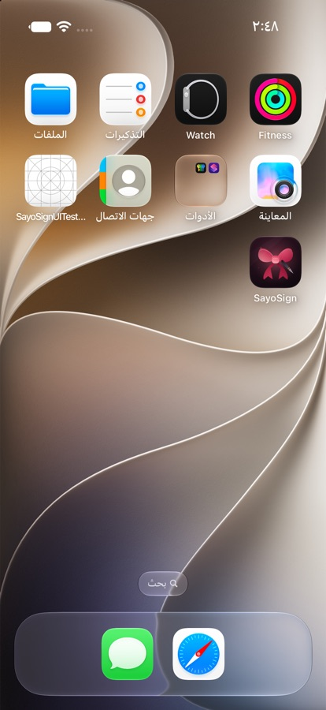 | 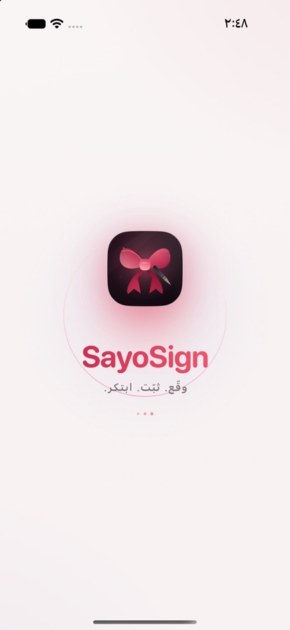 |
| 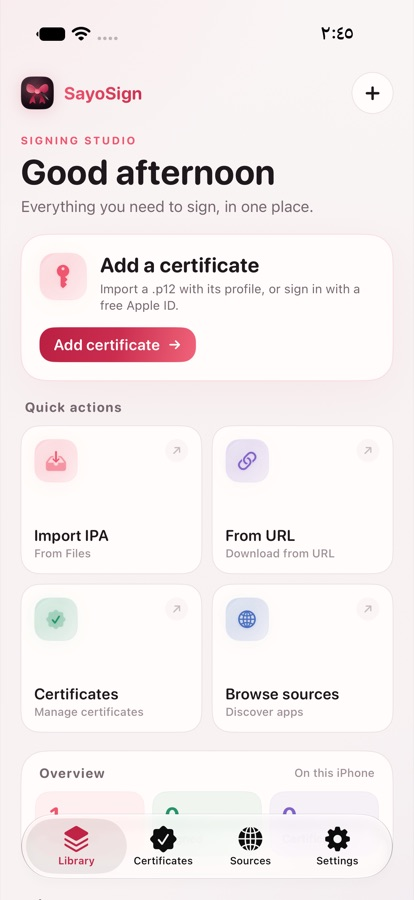 | 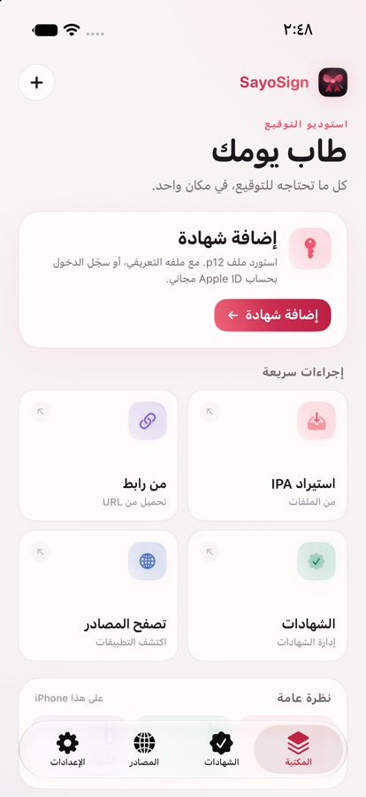 |
| 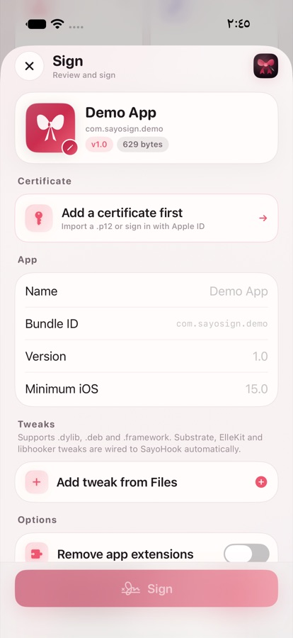 | 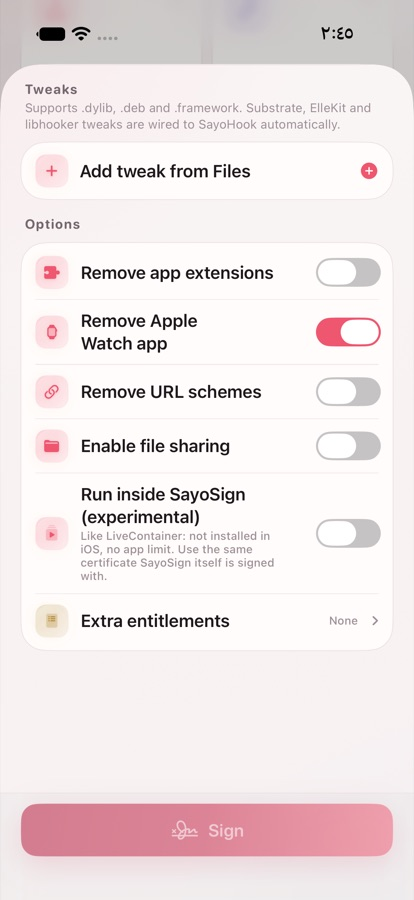 |
| 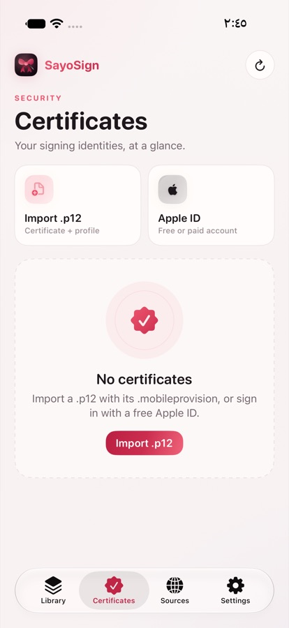 | 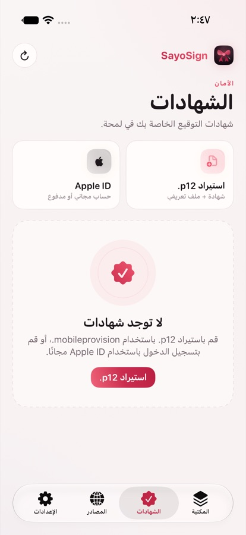 |
| 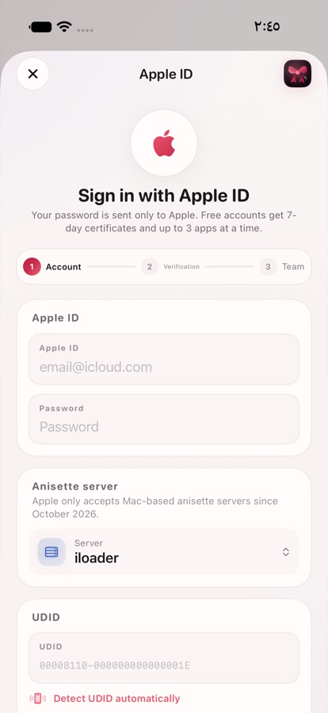 | 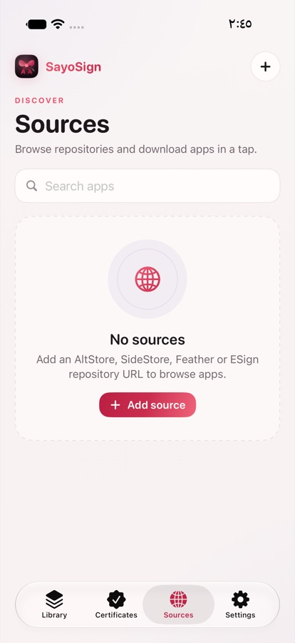 |
| 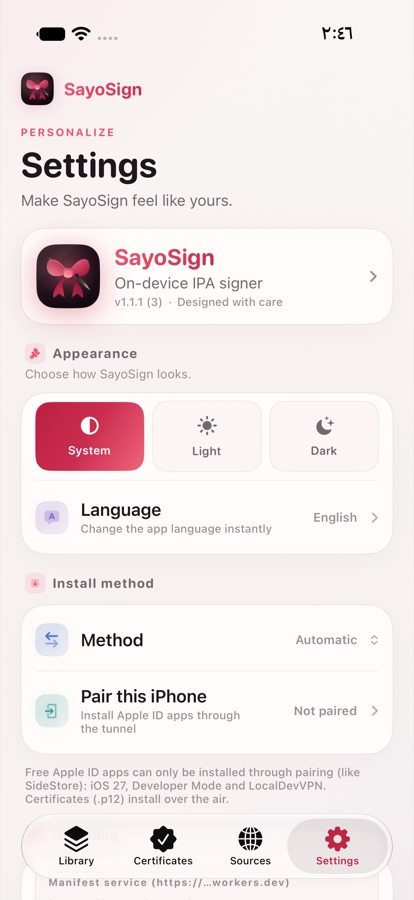 | 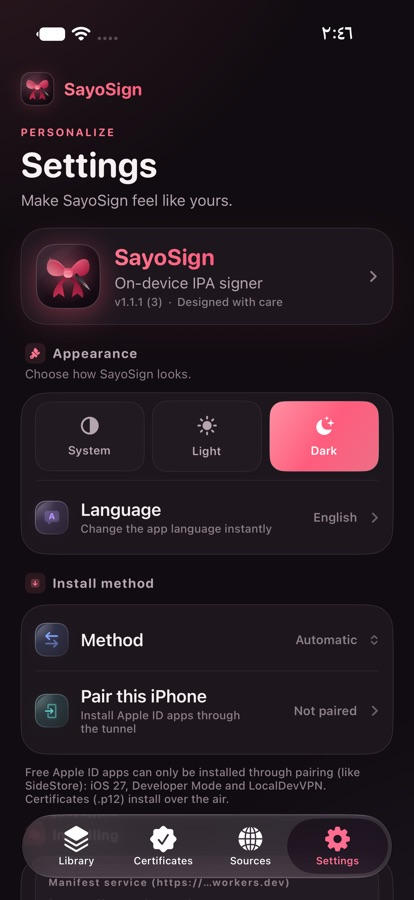 |
| 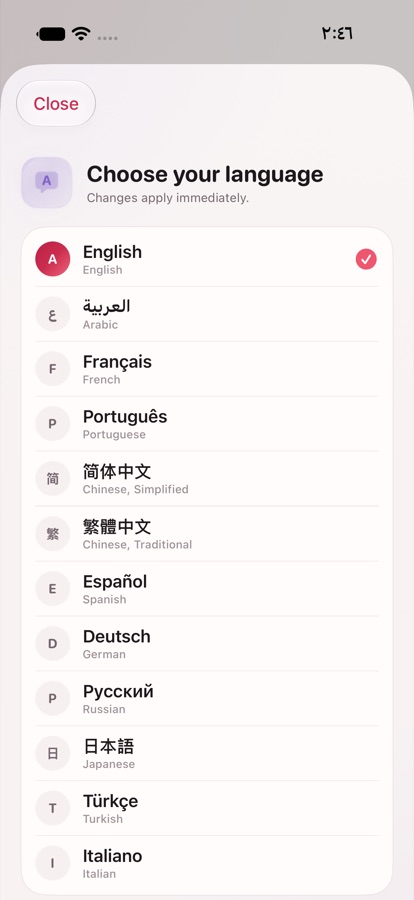 | 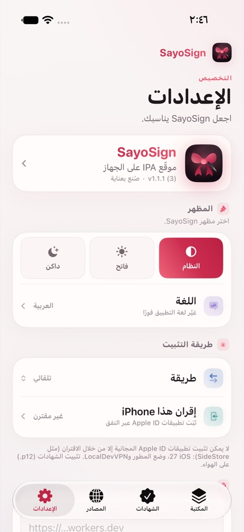 |
| 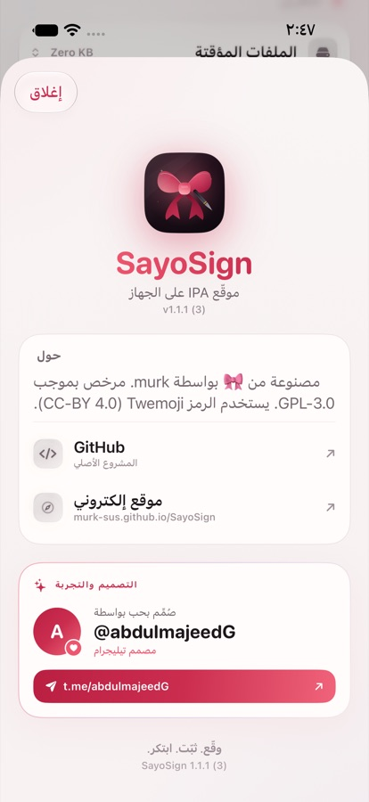 | 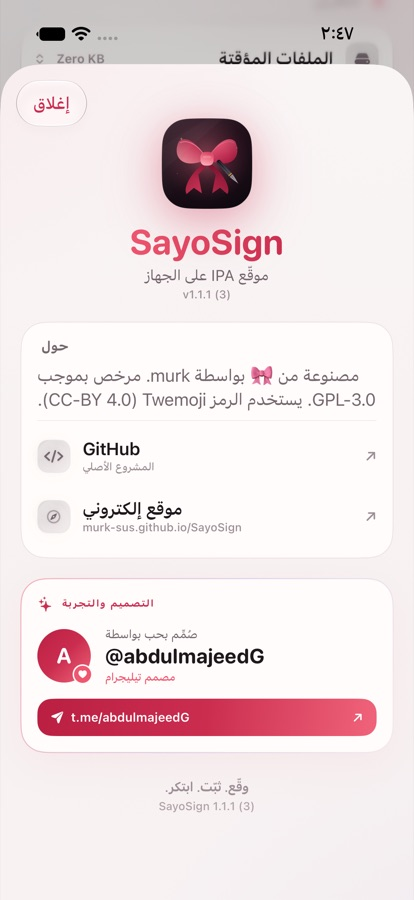 |
| 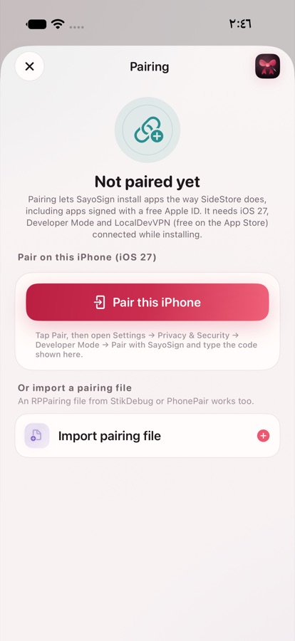 | 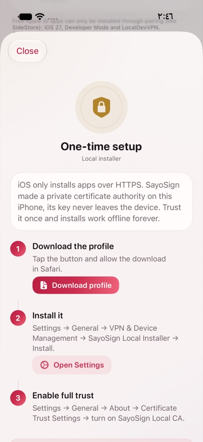 |
| 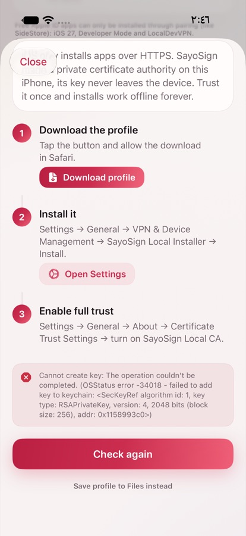 | 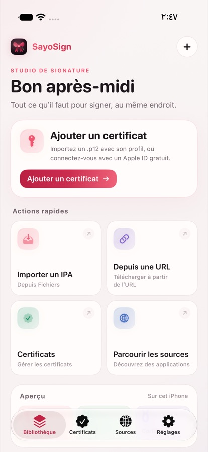 |

Additional captures: `03-library-with-app-en.jpg`, `10-add-source.jpg`,
`13-settings-dark-scrolled.jpg`, `21-settings-french.jpg`.
